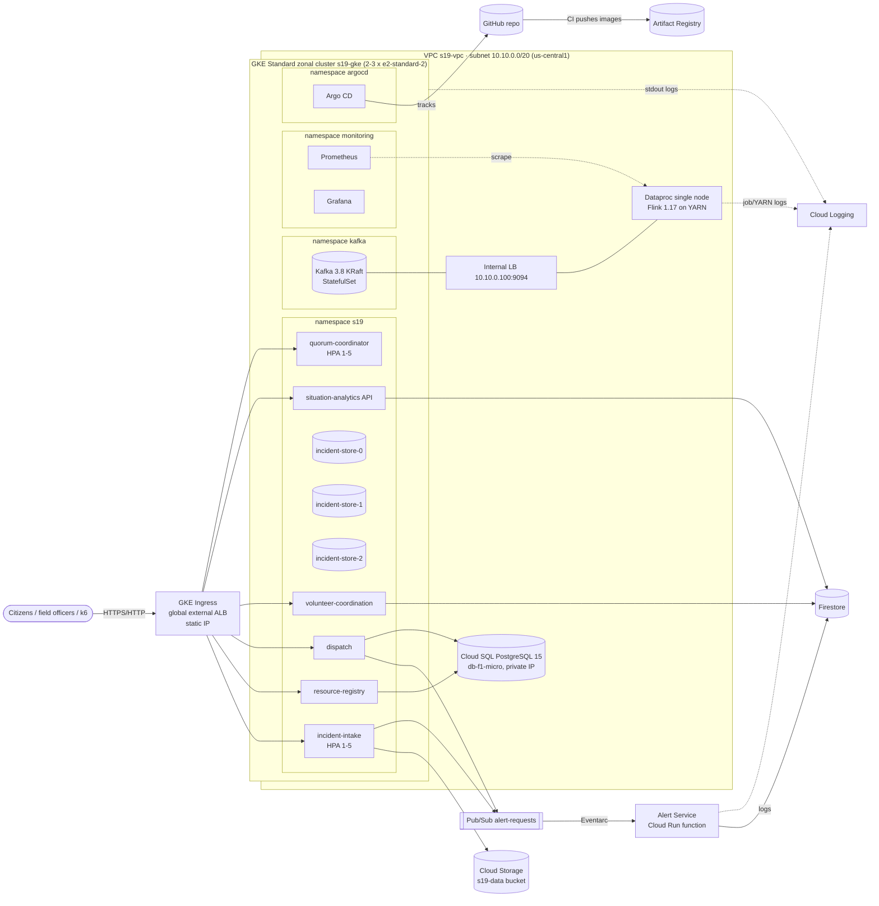
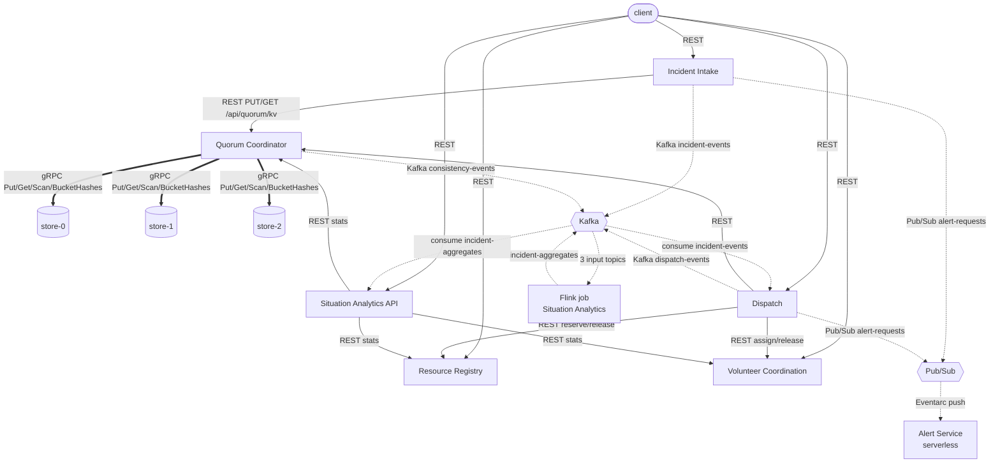
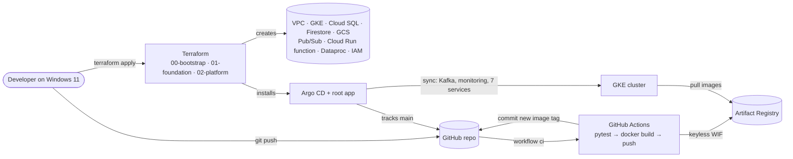

# S19 Disaster Management — System Design Document

CS/SS G527 Cloud Computing assignment · Scenario **S19 Disaster Management** · Concept **Leaderless replication (Dynamo-style storage)** · Cloud **Google Cloud Platform**

---

## 1. System overview

During a disaster (flood, cyclone, earthquake, fire), citizens and field officers report incidents; the emergency operations centre must store every report durably even while parts of the infrastructure are failing, dispatch vehicles/supplies/teams and volunteers, notify people, and see a live picture of the situation.

The system is built as **eight microservices** on GCP:

| # | Service | Runs on | Responsibility | Owns data in |
|---|---|---|---|---|
| 1 | **Incident Intake** | GKE (Deployment + **HPA**) | Public entry point. Validates reports, stores them through the quorum layer, emits events, triggers alerts for CRITICAL incidents, archives raw reports and attachments | GCS (`raw/`, `attachments/`) |
| 2 | **Resource Registry** | GKE | Vehicles, supply kits, response teams; atomic reservation with row locks | Cloud SQL (`resources`, `resource_reservations`) |
| 3 | **Replicated Incident Store** | GKE StatefulSet, 3 pods, 3 PVs | Three *independent* replicas storing incident versions + vector clocks; Merkle-lite bucket hashes; failure-injection hooks | Per-replica PersistentVolume (SQLite) |
| 4 | **Quorum Coordinator** | GKE (Deployment + **HPA**), stateless | N=3/W=2/R=2 quorum reads and writes, vector-clock versioning, sibling detection + semantic merge, read repair, anti-entropy | — (stateless) |
| 5 | **Dispatch** | GKE | Assigns resources + volunteers to incidents (manual REST and auto-dispatch from Kafka) | Cloud SQL (`dispatch_assignments`) |
| 6 | **Volunteer Coordination** | GKE | Volunteer registry, availability, heartbeats, transactional assignment; serves each volunteer's alert inbox and the regional bulletins | Firestore (`volunteers`, `volunteer_assignments`, reads `notifications`, `broadcasts`) |
| 7 | **Alert Service** | **Cloud Run functions (serverless)** | Asynchronous, event-driven: Pub/Sub message → recipients → real deliveries (volunteer inbox, regional broadcast, optional HTTPS webhook) → delivery record with per-delivery outcome | Firestore (`alerts`, `notifications`, `broadcasts`) |
| 8 | **Situation Analytics** | **Flink job on Dataproc** + query API on GKE | 1-minute event-time windows per region over incidents, dispatches and consistency events; surge detection; API that serves the results | Kafka `incident-aggregates` → Firestore (`analytics_windows`) |

The **public web service** required by the assignment is the GKE Ingress (global external Application Load Balancer, static IP) that exposes `/api/incidents`, `/api/resources`, `/api/dispatch`, `/api/volunteers`, `/api/analytics` and `/api/quorum`.

---

## 2. Cloud deployment architecture



**Provisioning:** every cloud resource above (VPC, subnet, firewall, Private Service Access, static IPs, GKE cluster/node pool, Cloud SQL, Firestore + index, bucket, Pub/Sub, Artifact Registry, Cloud Run function + Eventarc trigger, Dataproc cluster, all service accounts and IAM bindings, Workload Identity Federation for GitHub, optional budget) is created by **Terraform** in `infra/terraform/01-foundation`. `infra/terraform/02-platform` installs Argo CD and the cluster plumbing (namespaces, Workload-Identity service account, config map, secrets). From there **Argo CD** deploys every Kubernetes workload from Git.

---

## 3. Microservice architecture and interconnection



### 3.1 Communication matrix

| From → To | Mechanism | Endpoint / topic | Purpose |
|---|---|---|---|
| Client → Intake / Registry / Dispatch / Volunteer / Analytics / Coordinator | **REST** over GKE Ingress | `/api/...` | Public API |
| Intake → Quorum Coordinator | **REST** | `PUT/GET /api/quorum/kv/{id}` | Durable quorum write / read |
| Dispatch → Quorum Coordinator | **REST** | same | Read incident + vector-clock context, write `DISPATCHED` / `RESOLVED` |
| Dispatch → Resource Registry | **REST** | `POST /api/resources/reserve`, `/release` | Atomic reservation |
| Dispatch → Volunteer Coordination | **REST** | `POST /api/volunteers/assign`, `/release` | Transactional assignment |
| Analytics → Coordinator / Registry / Volunteer | **REST** | `/api/quorum/stats`, `/api/resources/stats`, `/api/volunteers/stats` | Situation summary |
| Quorum Coordinator → 3 replicas | **gRPC** (`proto/incident_store.proto`) | `Put, Get, Scan, GetBucketHashes, GetBucketDigests, Ping, SetFault` | Leaderless replication |
| Intake → Kafka | **Message queue** | `incident-events` | Event stream |
| Dispatch → Kafka (consume) | **Message queue** | `incident-events` (group `dispatch-auto`) | Auto-dispatch CRITICAL |
| Dispatch → Kafka | **Message queue** | `dispatch-events` | Resource-demand stream |
| Coordinator → Kafka | **Message queue** | `consistency-events` | Conflicts, read repairs, quorum failures |
| Flink → Kafka | **Message queue** | consumes 3 topics, produces `incident-aggregates` | Windowed analytics |
| Analytics API ← Kafka | **Message queue** | `incident-aggregates` | Persist results |
| Intake, Dispatch → Pub/Sub | **Message queue** | `alert-requests` | Alert requests |
| Pub/Sub → Alert Service | **Eventarc push** | CloudEvent `messagePublished` | Asynchronous serverless trigger |
| Alert Service → Firestore / webhook | Firestore writes; optional HTTPS POST | `notifications/{volunteer}/inbox`, `broadcasts/{region}/messages`, `ALERT_WEBHOOK_URL` | Distribute emergency updates |
| Client → Volunteer Coordination | **REST** | `GET /api/volunteers/{id}/notifications`, `/api/volunteers/broadcasts/{region}` | Read delivered alerts |

### 3.2 Event envelope (all Kafka topics)

```json
{"eventId":"...", "eventType":"INCIDENT_REPORTED|INCIDENT_UPDATED|DISPATCH_CREATED|DISPATCH_COMPLETED|CONFLICT_DETECTED|READ_REPAIR|QUORUM_FAILURE|ANTI_ENTROPY_REPAIR",
 "incidentId":"inc-…", "region":"north", "severity":"CRITICAL", "reporterId":"u1",
 "resourceCount":3, "volunteerCount":5, "ts":1763290000000}
```

Flink output (`incident-aggregates`): `region, windowStart, windowEnd, incidents, critical, updates, uniqueReporters, dispatches, resourcesDispatched, volunteersDispatched, resolved, conflicts, readRepairs, quorumFailures, antiEntropyRepairs, prevIncidents, baseline, surge, emittedAt`.

---

## 4. The distributed-systems concept: leaderless (Dynamo-style) replication

### 4.1 Why it fits disaster management
Incident reporting must keep working while infrastructure is degraded — a node, a zone or a network path can fail at any time. A leader-based database becomes unavailable for writes during leader election; a leaderless store keeps accepting writes as long as **W** replicas are reachable, and heals divergent replicas afterwards.

### 4.2 Design
* **N = 3** replicas (`incident-store-0/1/2`), each with its own PersistentVolume, no replica-to-replica traffic.
* **W = 2, R = 2 ⇒ R + W > N**: every read quorum intersects every write quorum, so a successful read sees the latest successful write. W and R are tunable per request (`?w=1`, `?r=3`) to *demonstrate* the trade-off.
* **Stateless coordinator** (`services/quorum-coordinator/app/quorum.py`) — any of its HPA-scaled pods can serve any request.
* **Versioning with vector clocks** (`services/common/s19common/vclock.py`). Each writer (`intake`, `dispatch`, `field-officer`, `coordinator`) increments its own entry. Clients pass back the `context` they read, giving read-your-writes causality.
* **Conflicts:** concurrent versions (neither clock descends the other) are kept by replicas as **siblings**. On read, the coordinator merges them with domain rules (`merge.py`): most advanced `status`, highest `severity`, max `peopleAffected`, union of `notes` / `assignedResources` / `assignedVolunteers`, LWW for other fields; it writes the merged version (with a merged clock) back so the siblings collapse.
* **Replica failure:** writes go to all N in parallel and return after W acks; slow or failed replicas do not block the quorum.
* **Read repair:** after a read returns, the coordinator waits for the remaining replicas and pushes the reconciled version to any replica whose digest differs.
* **Replica recovery / anti-entropy:** every 30 s (and on demand) the coordinator compares 256 bucket hashes per replica (Merkle-lite), drills into differing buckets and repairs only the keys that differ. A replica that was down or silently dropped writes converges without manual action.
* **Failure injection** (`SetFault` RPC; `POST /api/quorum/replicas/{id}/fault`, protected by `X-Admin-Token`): `down`, `slow`, `drop_writes`, `none`. Real crashes are shown with `kubectl delete pod incident-store-2` (the PV keeps the data; anti-entropy fills the gap).
* **Hinted handoff is deliberately not used:** with exactly N=3 nodes there is no spare node to hold hints, and keeping hints in the coordinator would make it stateful. Anti-entropy provides the same eventual repair.

### 4.3 Cross-service consistency (Dispatch ↔ incident store)
A dispatch touches three stores: Cloud SQL (resource reservation), Firestore (volunteer assignment) and the Dynamo store (incident becomes `DISPATCHED`). There is no distributed transaction, so Dispatch uses compensation:
* resources and volunteers are reserved independently (one unavailable service does not abort the other);
* if the incident write misses its write quorum, Dispatch releases the reservations, marks the dispatch row `FAILED`, and writes a **compensating version** that descends from the aborted one (the coordinator returns its vector clock even on failure). In a leaderless store a "failed" write may still have landed on a minority of replicas; the compensating version supersedes it there, so read repair and anti-entropy converge on the rollback instead of spreading the aborted dispatch;
* completing a dispatch releases resources and volunteers idempotently, so a completion that fails half-way can be retried.

### 4.4 Consistency testing
`tests/test_dynamo.py` (8 tests with real gRPC replicas), `scripts/consistency_test.py` (14 checks against the deployed system) and `scripts/e2e_check.py` (29 end-to-end checks across all services) cover: quorum write/read, write with one replica down, recovery via anti-entropy, read repair after silent data loss, concurrent writes → siblings → semantic merge → collapse, quorum loss (W=2 rejected, W=1 accepted), R=2 failing with two replicas down, convergence after recovery, and slow-replica tolerance.

---

## 5. Storage products and their purpose (requirement g)

| Product | Data | Why this product |
|---|---|---|
| **Cloud Storage** (object store) | Raw incident reports as NDJSON batches (`raw/incidents/YYYY/MM/DD/HH/`), attachments (`attachments/<id>/`), function source, Flink jar and Dataproc staging | Cheap, immutable, append-only audit trail; batching keeps Class-A operations low |
| **Cloud SQL for PostgreSQL** | `resources`, `resource_reservations`, `dispatch_assignments` | Relational integrity (FKs, CHECKs), transactions with `SELECT … FOR UPDATE SKIP LOCKED` so two dispatchers never reserve the same vehicle |
| **Firestore (Native)** | `volunteers`, `volunteer_assignments`, `alerts`, `notifications`, `broadcasts`, `analytics_windows` | Semi-structured, high-churn documents (availability flips, heartbeats, alert delivery reports, window results); serverless, free quota |
| *(Replica PersistentVolumes)* | Incident versions inside the Dynamo store | Part of the concept implementation, not counted among the three products |

---

## 6. Observability (requirement h)

* **Metrics:** every service exposes `/metrics` (`http_requests_total`, `http_request_duration_seconds`, quorum/replica/anti-entropy counters). kube-prometheus-stack (Prometheus, Grafana, kube-state-metrics, node-exporter) scrapes them through a `ServiceMonitor`; Flink's Prometheus reporter on the Dataproc VM is scraped through the `monitoring/flink-metrics` Service.
* **Dashboard** `S19 Disaster Management – Overview` (`deploy/platform/monitoring/extras/dashboards/s19-overview.json`): RPS, 5xx error rate, p50/p95/p99 latency per service, HPA current/desired replicas, pod CPU/memory, node readiness, pod restarts, quorum results, read repairs, conflicts, replica up/fault mode, Flink uptime/checkpoints/records-per-second/custom counters, analytics window lag.
* **Centralised logging:** all services log one JSON object per line; GKE ships container logs to **Cloud Logging**, Dataproc ships Flink driver and YARN container logs, Cloud Run functions ship the Alert Service logs — one place to query everything (`jsonPayload.service="quorum-coordinator"`).

---

## 7. Rationale behind the main cloud design choices

| Decision | Alternatives considered | Reason |
|---|---|---|
| GKE **Standard, zonal**, e2-standard-2 nodes, optional Spot | Autopilot, regional cluster | One zonal cluster's management fee is covered by the GKE free-tier credit; Standard gives predictable node cost and room for Kafka/Prometheus/Argo CD; Spot cuts node cost for development |
| **Self-hosted single-broker Kafka** on GKE (KRaft) | Managed Service for Apache Kafka, Confluent Cloud | The assignment allows (not requires) managed Kafka; self-hosting removes an always-on hourly charge. Dataproc reaches it through an internal LB on a fixed IP |
| **Dataproc single-node** with the Flink component, created on demand with idle auto-delete | Dataproc multi-node, Flink on GKE | Meets "Flink on a managed cluster" at the smallest size; only exists while needed |
| **Cloud SQL db-f1-micro, private IP, HDD, no backups**, stoppable | Larger tiers, AlloyDB | Cheapest Cloud SQL tier; private IP avoids the Auth Proxy and public IP charges |
| **Alert Service as Cloud Run function** (Pub/Sub trigger) | Cloud Run service, Dispatch-internal | Truly asynchronous and bursty; scales to zero; fits free invocations |
| **Argo CD app-of-apps**, installed by Terraform | Flux, Config Sync | Clear UI for the demo; one Git path per concern; Terraform only bootstraps it |
| **Workload Identity** + Workload Identity Federation for CI | JSON keys | No long-lived keys in the cluster or in GitHub |
| **Prometheus/Grafana self-hosted**, Google Managed Prometheus disabled | GMP | GMP bills per sample; self-hosted on existing nodes costs nothing extra |
| **Cloud Logging** | EFK, Loki | Already integrated with GKE, Dataproc and functions; 50 GiB/project/month free |
| Alert delivery to Firestore inboxes + optional webhook | SMS/push provider (Twilio, FCM) | Real, verifiable delivery at zero messaging cost; the webhook channel reaches any external system (Slack, Discord, ntfy) without new dependencies |
| Local stack with the same single entry point (nginx gateway on `localhost:8080`) | per-service ports | Every script, test and command works unchanged against local and GKE by switching `BASE_URL` |
| PowerShell helpers + Docker-based builds (Maven, tests) | Linux-only scripts | The team works on Windows 11; only Docker Desktop, gcloud, Terraform and k6 are required |
| Region **us-central1** | asia-south1 (closer to Pilani) | Always-Free Cloud Storage applies to us-central1/us-east1/us-west1; widest service availability. Latency from India (~250 ms) is acceptable for the demo |

---

## 8. Delivery pipeline (IaC → images → GitOps)



* Terraform owns **cloud** resources; Argo CD owns **Kubernetes** resources. Terraform's Kubernetes provider only creates the plumbing Argo CD cannot get from Git without leaking secrets (namespaces, the Workload-Identity service account, the cloud ConfigMap, Secrets) and Argo CD itself.
* No human or CI job runs `kubectl apply` for services. CI's only deployment action is a Git commit that changes the image tag in `deploy/k8s/overlays/gcp/kustomization.yaml`.

## 9. Local vs cloud environments

| Concern | Local (`docker compose`) | GCP |
|---|---|---|
| Entry point | nginx gateway `localhost:8080` (same path routing as the Ingress) | GKE Ingress (global external ALB, static IP) |
| Incident replicas | 3 containers with named volumes | StatefulSet, 3 pods, 3 PersistentVolumes |
| Kafka | `apache/kafka:3.8.0` container | same image as a StatefulSet on GKE + internal LB for Dataproc |
| Relational | `postgres:15` container | Cloud SQL PostgreSQL 15 (private IP) |
| Firestore / Pub/Sub | official `gcloud` emulators | Firestore (Native) / Pub/Sub |
| Object store | fake-gcs-server | Cloud Storage |
| Alert Service | Functions Framework container (same code), Pub/Sub emulator push subscription | Cloud Run functions gen2, Eventarc trigger |
| Flink | Flink 1.17.2 JobManager/TaskManager containers (profile `flink`) | Dataproc 2.2 (Flink 1.17.0 on YARN) |
| Monitoring / logging | container logs (`docker compose logs`) | Prometheus + Grafana on GKE, Cloud Logging |

The application code is identical in both: the Google client libraries switch to the emulators when the `*_EMULATOR_HOST` variables are set.
